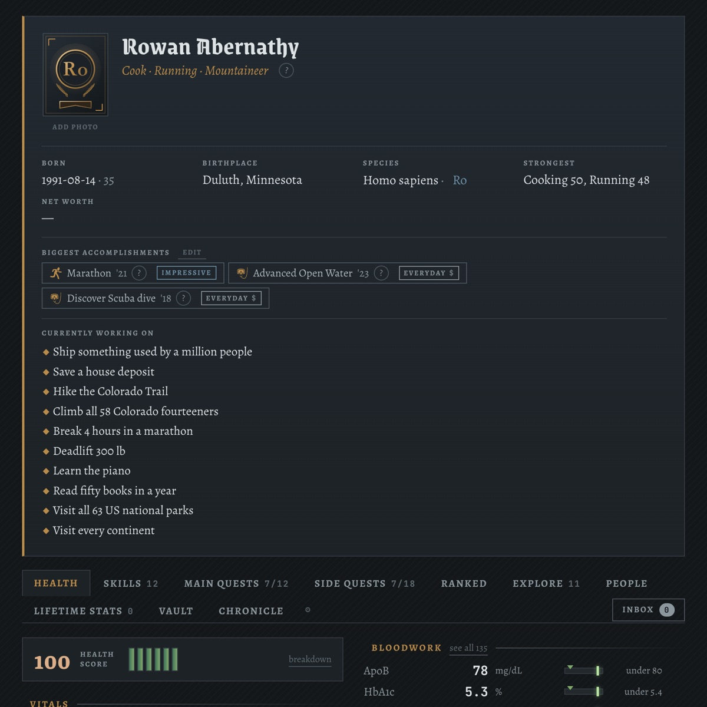
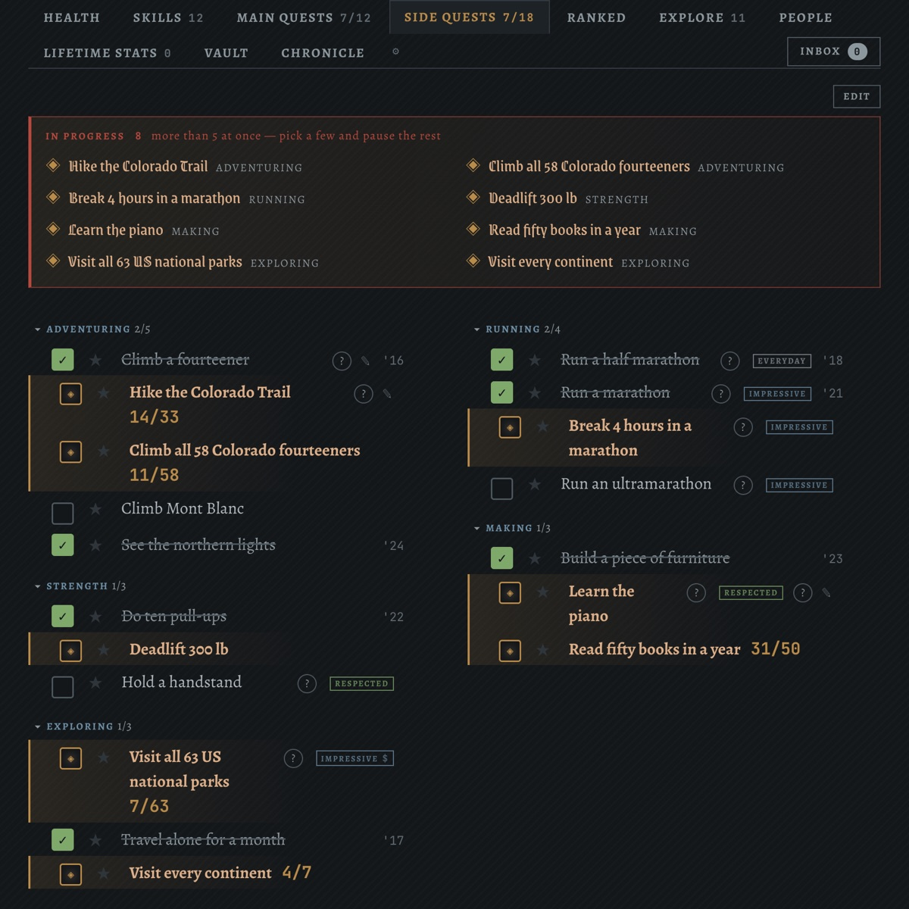
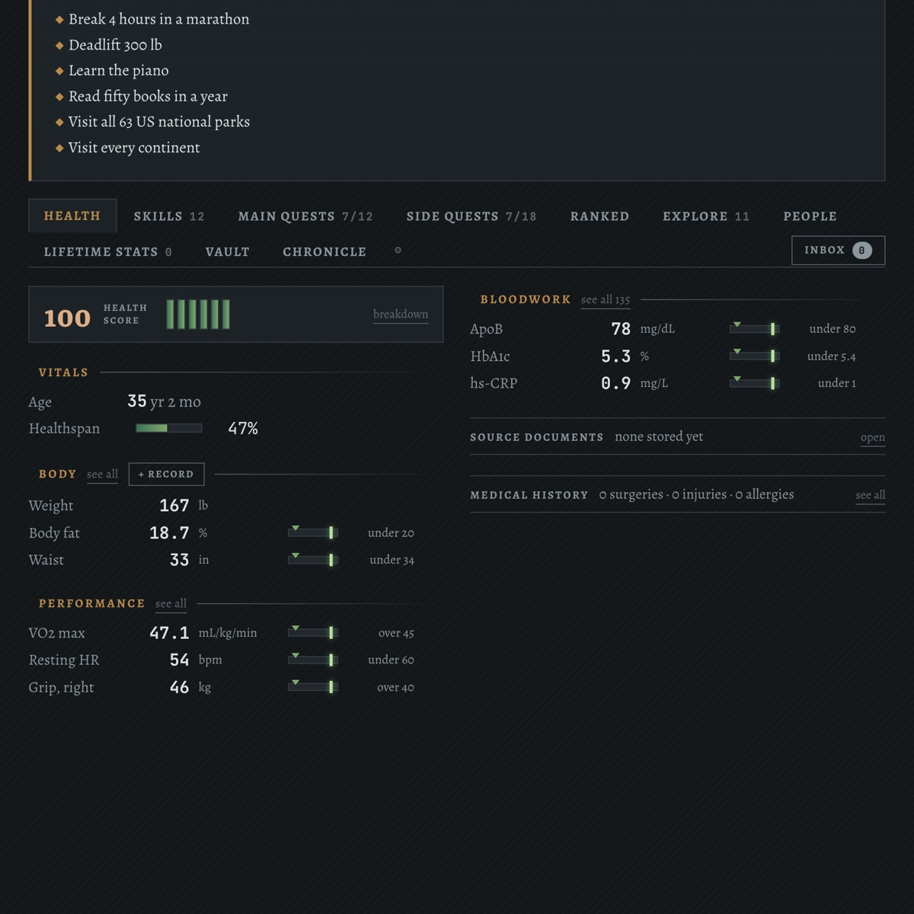
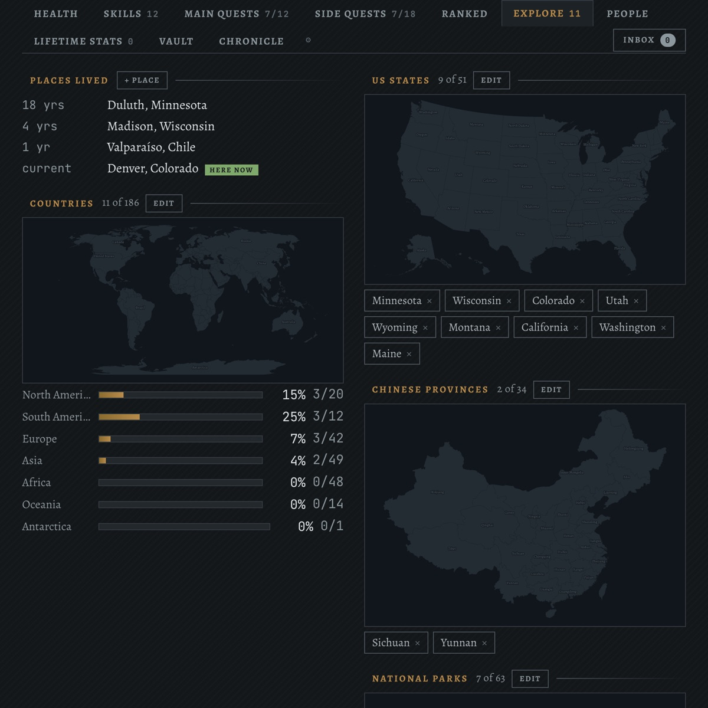

# Character Sheet

A life dashboard shaped like a roguelike character dump. Quests, skills with
derived levels, health metrics, and an atlas — updated by talking to it.

Screenshots show the fictional sample character every new account starts with
(Rowan Abernathy, from `src/seed.ts`).


*The character card: title derived from top skills, accomplishments, and what's in progress.*


*Side quests grouped by track, with progress counts and a warning when too many are open at once.*


*Health: a score, body and performance readings, and bloodwork against targets.*


*The atlas: places lived, countries by continent, US states and other maps.*

### Sample mode

To look around without an account or a backend, run `npm run dev` and open
http://localhost:5174/sample.html. It renders the sample character in memory:
there is no sign-in, every Supabase request is blocked in the page, and writes
do nothing. It is dev only and not part of the production build. Add
`?tab=skills` (or any tab name) to open a tab directly.

## Backend

Data lives in Supabase. Every table is `cs_`-prefixed, so the app can share a
project with other apps (it was built alongside a habit tracker, Homebase, and
can optionally read that app's `monthly_reflections`, `routines` and
`user_settings` tables when they exist).

## Setup

```bash
npm install
cp .env.example .env.local   # then fill in your Supabase URL and anon key
npm run dev                  # http://localhost:5174
```

Before first run, apply the schema to your Supabase project. The files in
`supabase/migrations/` are idempotent and build the full schema from nothing:
every `cs_` table with row level security (each user sees only their own rows),
plus the private `character-sheet` storage bucket used for uploaded documents
and portraits. Either:

- **CLI:** `supabase link --project-ref <your-ref>` then `supabase db push`, or
- **Dashboard:** paste each file into the SQL editor and run them in filename
  order.

Sign-in is Google OAuth: enable the Google provider under Authentication →
Providers and add your dev URL (http://localhost:5174) to the redirect URLs. The
first time you sign in, the app seeds your account with the sample character.

The chat needs an Anthropic API key. It reads
`user_settings.settings.anthropicApiKey` if that table exists; if it
isn't found, the prompt asks for one and keeps it in `localStorage`.

## How skill levels work

A level is never typed in. Each skill declares **what 100 means**, and carries a
ladder of milestones:

```
Diving — 100 = PADI Divemaster
    5  Discover Scuba dive
   20  Open Water
   35  Advanced Open Water
   55  Rescue Diver
   75  100 logged dives
  100  Divemaster
```

Your level is the highest rung you've ticked. If the next rung tracks partial
progress (Seven Summits, 1 of 7), the level moves proportionally toward it
instead of waiting for the whole thing. See `src/skills.ts`.

Three ways to change one:

- Click the `?` next to a skill and tick a rung.
- Tell the chat: *"I got my rescue diver cert"*.
- Add a rung the ladder doesn't have yet, via chat.

## Updating by chat

The prompt at the bottom writes to the database through Claude tool use
(`src/agent.ts`, `claude-opus-5`). It can log measurements, define new metrics,
tick milestones, add and complete quests, add countries and animals, and edit
the character card. It's given the whole sheet with real row IDs each turn, so
"mark the marathon done" resolves without you naming an ID.

## Layout

| File | What it holds |
|---|---|
| `src/skills.ts` | The level formula |
| `src/seed.ts` | First-run content: a fictional sample character |
| `src/agent.ts` | Claude tools and the tool-use loop |
| `src/Sheet.tsx` | The dump itself |
| `src/Chat.tsx` | The `>` prompt |

## Seeded content

A new account is seeded with **Rowan Abernathy, a fictional sample
character**: a dozen skill ladders at different levels, quests that are done,
in progress (some with partial counts) and locked, a few years of body,
performance and lab readings so the charts and health score have something to
draw, and an atlas with cities lived, countries, states, provinces, national
parks and animals. None of it describes a real person. The seeder only fills
empty tables and only adds sample readings to a brand-new account, so edit or
delete it freely.
